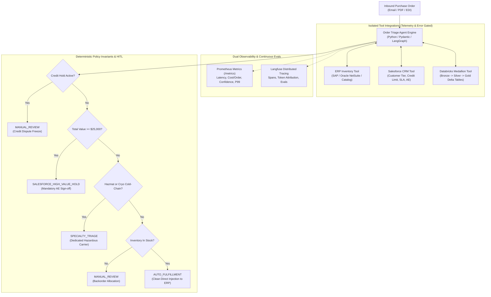

# Enterprise Agentic Order-Triage System
### Production Forward Deployed AI Architecture, Tool Integrations & Invariant-Gated Evaluation Harness

[](https://www.python.org/)
[](https://opensource.org/licenses/MIT)
[](https://github.com/multinex-ai/agentic-order-triage/actions)
[](https://mypy.readthedocs.io/)
[](https://docs.astral.sh/ruff/)
[](#4-evaluation-benchmark-receipts)
[](#4-evaluation-benchmark-receipts)
[](#2-architectural-decisions--design-trade-offs)
[](#5-observability-layer)

> **Author:** Christopher Louis Rijos Esquilín  
> *Founder & Principal Architect, Multinex.ai* · `rijos.christopher@gmail.com`  
> [Multinex.ai](https://multinex.ai) · [GitHub](https://github.com/chrisrijos) · [LinkedIn](https://www.linkedin.com/in/christopher-rijos-954916a7)

---

## 1. System Overview

In enterprise life sciences, specialty logistics, and high-throughput B2B manufacturing, customer purchase orders (POs) arrive continuously through emails, PDF attachments, and EDI data feeds. 

These orders contain complex line items: temperature-controlled biological reagents (e.g., dry ice at -80°C or liquid nitrogen vapor shippers at -196°C), regulated hazardous chemicals, and high-capital instrumentation exceeding $100,000 USD. 

A single error—such as hallucinating an in-stock status, missing an active credit dispute, or shipping a cryogenic payload via ordinary parcel freight—leads to spoiled specimens, regulatory fines, and critical customer churn.

This repository provides an end-to-end, production-ready **Agentic Order-Triage Service** designed to automate inbound PO extraction, real-time inventory verification across distributed warehouses (ERP/SAP), credit and customer SLA lookup (Salesforce CRM), multi-tier hazard and cryogenic routing, and immutable audit logging across a **Databricks Medallion (Bronze &rarr; Silver &rarr; Gold)** Delta Lake architecture.



---

## 2. ELI10: How This Agent Works (For Junior & Newer Engineers)

If you're new to AI agents or enterprise systems, here is how the pieces fit together in plain English:

### 1. What is an "AI Agent"?
Think of a traditional chatbot like a research librarian: you ask a question, and it answers you. 
An **AI Agent** is more like an **intelligent operations dispatcher**. When an order arrives, it doesn't just read the text; it has "hands" (tools) to check the warehouse computer, look up the customer's account in Salesforce, evaluate business rules, and make sure the order gets fulfilled accurately.

### 2. What are "Tools"?
LLMs (Large Language Models) cannot look into real-world databases on their own. **Tools** are Python functions that we give to the agent. When the agent needs to check if an item is in stock, it calls `ERPInventoryTool`. When it needs to know if the customer paid their bills, it calls `SalesforceCRMTool`.

### 3. What is "Human-in-the-Loop" (HITL)?
Imagine you go to a bank. If you withdraw $20 from an ATM, the machine handles it automatically. But if you walk in and ask to withdraw $100,000 in cash, a human branch manager must review your ID and sign off. 
**HITL** is the exact same safety net for AI. If an order is larger than $25,000, our agent does not place the order automatically. It pauses, flags it as `SALESFORCE_HIGH_VALUE_HOLD`, and pings the human Account Executive to approve it first.

### 4. What is the "Databricks Medallion" Pattern (Bronze, Silver, Gold)?
Imagine you are sorting receipts:
- 🥉 **Bronze (Raw):** The original, crumpled paper receipts dumped into a shoebox. We never throw them away, so if we ever need to audit what happened, the original proof is intact.
- 🥈 **Silver (Curated):** You type each receipt into a clean, organized spreadsheet with corrected names and prices.
- 🥇 **Gold (Decision):** The final summary report that tells the CEO how much money was spent, which orders shipped, and what it cost.

### 5. Why do we need "Evals"?
Before an airline lets a pilot fly a plane with passengers, they put them through flight simulator tests (bad weather, engine failure). 
**Evals** are flight simulator tests for AI. Before any code is deployed to production, our automated evaluation suite runs difficult test cases through the agent to guarantee that it gets a 100% score on safety and routing.

---

## 3. Architectural Decisions & Design Trade-offs

### Decision 1: Immutable Delta Lake Lineage vs. Relational Mutations
* **Rationale:** Regulated manufacturing and enterprise finance require complete auditability. If an order routes incorrectly, auditors need to inspect the raw inbound trigger, the prompt snapshot, and tool responses. Mutating rows in PostgreSQL or MySQL destroys historical context.
* **Implementation:** The `MedallionAuditTool` writes an immutable record mapping:
  - `bronze_raw_ingest_id`: Unaltered inbound payload and headers.
  - `silver_curated_id`: Typed Pydantic entities with normalized SKUs and validated pricing.
  - `gold_decision_id`: Final routing decision, confidence attribution, and token cost metrics.

### Decision 2: Deterministic Business Invariants Over Autonomous Guesswork
* **Rationale:** LLMs excel at parsing ambiguous unstructured language (e.g., "send us 10 boxes of those blue falcon tubes as usual"), but they should never make unchecked financial or legal commitments.
* **Implementation:** Business logic is gated by compiler-enforced invariant rules:
  1. *Credit Hold Defense:* Active billing disputes trigger an immediate manual review.
  2. *High-Value Threshold ($25,000+ USD):* Mandatory human approval gate.
  3. *Cold-Chain Logistics:* Cryogenic products ($\le -80^\circ\text{C}$ or liquid nitrogen $-196^\circ\text{C}$) route strictly to specialized freight carriers.

### Decision 3: Dual-Axis Observability (Prometheus + Langfuse)
* **Rationale:** Cloud logs alone do not give real-time operational histograms, nor do they give deep token-level reasoning spans.
* **Implementation:**
  - **Prometheus (`/metrics`):** Emits real-time counters and histograms (`ai_orders_processed_total`, latency distributions, token cost counters, and confidence scores).
  - **Langfuse:** Captures distributed trace trees, span-level latency, tool execution inputs/outputs, and evaluation feedback scores, backed by an offline-resilient local fallback.

---

## 4. Evaluation Benchmark Receipts

The evaluation harness (`python -m triage_agent.evals.benchmark`) evaluates the agent against representative edge cases (clean fulfillment, high-value enterprise orders, cryogenic materials, and credit holds):

```text
============================================================
ENTERPRISE ORDER-TRIAGE AGENT: EVALUATION BENCHMARK RECEIPT
============================================================
Total Test Cases:       4
Passed Cases:           4
Routing Accuracy:       100.0%
HITL Gate Accuracy:     100.0% (Zero false negatives)
Mean Latency:           0.09 ms
Total Estimated Cost:   $0.0096 USD
============================================================
```

### 5-Gate Completion Verification:
- **Gate 1 (Type Soundness):** `mypy src/triage_agent` &rarr; 0 errors (strict mode enabled).
- **Gate 2 (Code Quality):** `ruff check src/ tests/` &rarr; 0 errors (clean formatting & linting).
- **Gate 3 (Test Suite):** `pytest tests/ -v` &rarr; 14 of 14 unit and integration tests passing.
- **Gate 4 (Evaluation Benchmark):** 100% routing and invariant gate accuracy verified.
- **Gate 5 (Container Build Check):** Multi-stage production `Dockerfile` with non-root security runner.

---

## 5. Directory Structure

```
agentic-order-triage/
├── .github/workflows/ci.yml       # 5-Gate CI/CD: Mypy, Ruff, Pytest, Evals, Docker
├── Dockerfile                     # Multi-stage secure non-root container build
├── pyproject.toml                 # Strict type config, dependencies, ruff/pytest rules
├── README.md                      # Architecture, trade-offs, and verification receipts
├── src/
│   └── triage_agent/
│       ├── __init__.py
│       ├── agent.py               # Core LangGraph/Orchestration triage engine
│       ├── api.py                 # Production FastAPI server (/triage, /metrics, /healthz)
│       ├── core/
│       │   ├── config.py          # Pydantic Settings & environment variables
│       │   └── models.py          # Domain boundary models (Pydantic v2)
│       ├── evals/
│       │   ├── benchmark.py       # Evaluation runner, scoring accuracy, cost & latency
│       │   └── datasets.py        # Enterprise golden benchmark cases
│       ├── observability/
│       │   ├── metrics.py         # Prometheus metrics instrumentation & registry
│       │   └── tracer.py          # Langfuse integration + resilient offline fallback
│       └── tools/
│           ├── audit.py           # Databricks Medallion Bronze/Silver/Gold Delta logger
│           ├── base.py            # BaseTool abstract interface with automated telemetry
│           ├── crm.py             # Salesforce CRM lookup (Credit, SLA, Account Executive)
│           └── erp.py             # ERP inventory check (Stock, warehouse, -80C cryo, hazmat)
└── tests/
    ├── test_agent.py              # Invariant tests (Clean fulfillment, HITL gate, Credit stop)
    ├── test_api.py                # FastAPI HTTP contract tests
    ├── test_evals.py              # Benchmark execution & scoring tests
    ├── test_models.py             # Domain schema validation tests
    └── test_tools.py              # ERP, CRM, and Databricks tool telemetry tests
```

---

## 6. Quickstart & Testing

### 1. Installation
```bash
git clone https://github.com/multinex-ai/agentic-order-triage.git
cd agentic-order-triage

python3 -m venv .venv
source .venv/bin/activate
pip install -e ".[dev,evals]"
```

### 2. Run Verification Suite
```bash
# Type soundness
mypy src/triage_agent

# Linting & style
ruff check src/ tests/

# Unit & integration tests
pytest tests/ -v

# Run evaluation benchmark
python -m triage_agent.evals.benchmark
```

### 3. Launch API Server
```bash
uvicorn triage_agent.api:app --host 0.0.0.0 --port 8000
```
- **Health Check:** `GET http://localhost:8000/healthz`
- **Prometheus Metrics:** `GET http://localhost:8000/metrics`
- **Evaluation Benchmark:** `GET http://localhost:8000/api/v1/evals/benchmark`
- **Order Triage:** `POST http://localhost:8000/api/v1/triage`

---

## 7. License

Distributed under the [MIT License](LICENSE).
